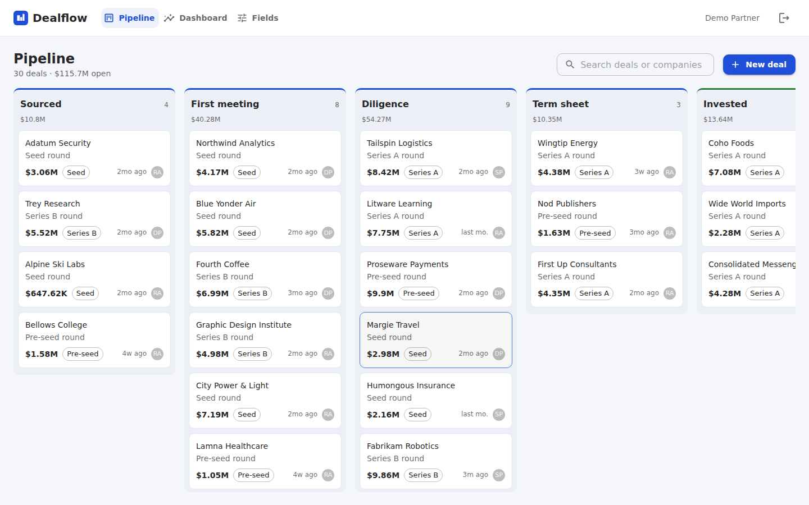
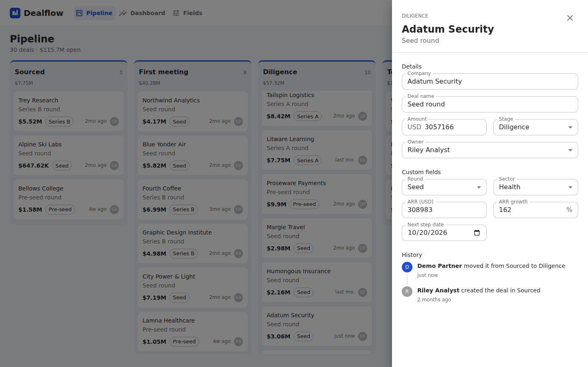
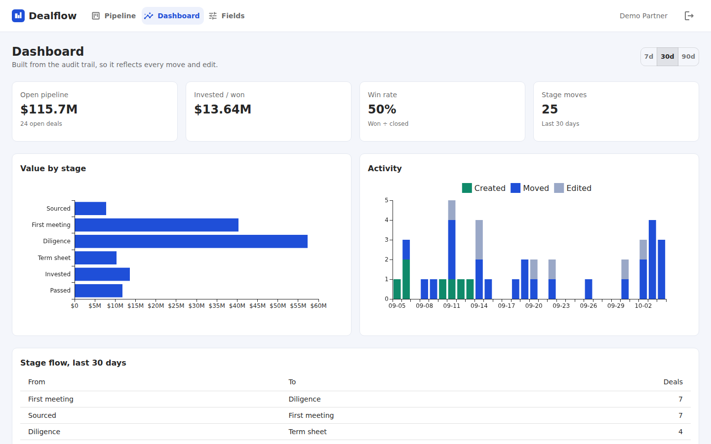

# Dealflow

A deal pipeline tracker for investment teams. Deals move across a drag-and-drop
board, each team defines its own custom fields, and every change is written to an
audit trail that also feeds the dashboard.



| Deal details and history                         | Dashboard                                    |
| ------------------------------------------------ | -------------------------------------------- |
|  |  |

## Features

- **Pipeline board.** Drag deals between stages and reorder them within a stage.
  Moves show up straight away and roll back if the server rejects them.
- **Custom fields.** Text, number, metric (with a unit), date and single-select
  fields, defined per organisation. Renaming keeps the field key; archiving hides
  the field but keeps its values and history.
- **Audit trail.** Creation, stage moves, attribute edits and field edits are
  recorded with who made them, old and new values, and when. The deal drawer
  shows them as a timeline.
- **Dashboard.** Open pipeline value, win rate, value by stage, daily activity
  and stage-to-stage flow for the last 7, 30 or 90 days, all computed from the
  audit trail.
- **Multi-tenant.** Every query is scoped to the signed-in user's organisation,
  and the tests check that one organisation can't read or change another's data.

## Stack

| Layer            | Technology                                                                     |
| ---------------- | ------------------------------------------------------------------------------ |
| Web (`apps/web`) | React 18, TypeScript, Vite, Material UI, TanStack Query, dnd-kit, MUI X Charts |
| API (`apps/api`) | Node.js 22, TypeScript, GraphQL Yoga, Drizzle ORM, Zod, JWT (jose), bcrypt     |
| Database         | PostgreSQL 17 in production; embedded PGlite for local development and tests   |
| Tooling          | npm workspaces, Vitest, Testing Library, Prettier, GitHub Actions, Docker      |

## Design decisions

**Ordering with fractional keys.** Each card stores a base-36 position string.
Dropping a card between two others generates a key that sorts between theirs
([`position.ts`](apps/api/src/lib/position.ts)), so a move updates one row
instead of renumbering the column. The client sends the neighbours it saw, and
the server fills in a missing one itself so a stale client can't create
duplicate keys.

**History in the same transaction.** Every mutation in
[`deals.ts`](apps/api/src/services/deals.ts) compares old and new values and
writes the history rows in the same transaction as the change. Unchanged values
write nothing. History rows copy stage names, so the timeline still reads
correctly after a stage is renamed.

**One validation point for custom fields.** Values arrive as JSON and are
checked against the field type in [`fields.ts`](apps/api/src/services/fields.ts)
before they are stored.

**No N+1 queries.** Stages, owners, field definitions and field values are
resolved through per-request DataLoaders, so a board of any size costs a fixed
number of queries.

**Tests without a database server.** The same Drizzle schema and migrations run
on PGlite (Postgres compiled to WebAssembly) in tests and on a real Postgres in
production. CI runs the test suite on PGlite and checks the migrations and seed
against Postgres 17.

**Safe errors.** Validation and permission errors reach the client with a
message and a code (`BAD_USER_INPUT`, `NOT_FOUND`, `UNAUTHENTICATED`).
Anything unexpected is masked. Sign-in compares against a dummy hash for
unknown emails, so response time doesn't reveal which accounts exist.

## Running locally

Requires Node.js 22.

```bash
npm install
cp apps/api/.env.example apps/api/.env   # then set JWT_SECRET (openssl rand -hex 32)
npm run dev                              # API on :4000, web on :5173
```

The API uses an embedded database in `apps/api/.data` and seeds a demo
organisation. Sign in as `demo@dealflow.dev` / `demo1234`.

### With Docker and Postgres

```bash
JWT_SECRET=$(openssl rand -hex 32) docker compose up --build
```

The app is served on http://localhost:8080, with the API and the web app on one
origin.

## Tests

```bash
npm test          # 58 tests: services, GraphQL API, auth, board logic, formatting
npm run typecheck
npm run format:check
```

## Project layout

```
apps/
  api/
    drizzle/              SQL migrations
    src/db/               schema, database client, demo seed
    src/services/         deals, custom fields, reports (business logic)
    src/graphql/          type definitions, resolvers, DataLoaders
    src/auth.ts           JWT and password hashing
  web/
    src/features/board/   board, drag-and-drop, move planning
    src/features/deal/    deal drawer, field editors, history timeline
    src/features/dashboard/
    src/features/fields/  custom field admin
```

## License

MIT
